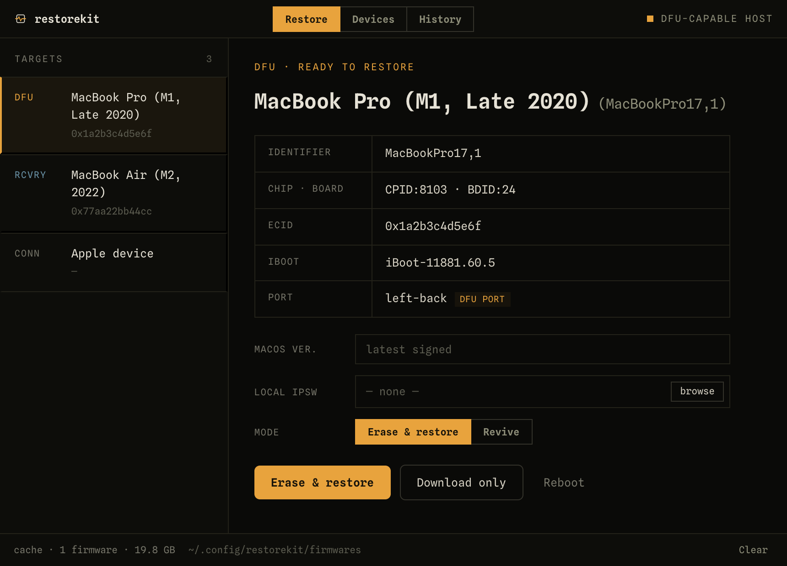

# restorekit

**Wipe, revive, and restore T2 and Apple Silicon macs from macOS, linux, or windows. No apple tools required.**

[](https://github.com/fcjr/restorekit/actions/workflows/ci.yml)
[](https://crates.io/crates/restorekit-cli)
[](https://docs.rs/restorekit)
[](LICENSE)

`restorekit` is a standalone desktop app, CLI, and rust library for restoring T2 and Apple Silicon macs over USB from macOS, linux, or windows. Everything runs on a self-contained cross-platform stack built with rust, [libirecovery](https://github.com/libimobiledevice/libirecovery), and [idevicerestore](https://github.com/libimobiledevice/idevicerestore), so you don't need Apple Configurator, iTunes, Finder, or a second mac.

<picture>
  <source media="(prefers-color-scheme: dark)" srcset="apps/landing/src/assets/app-restore-dark.png">
  <source media="(prefers-color-scheme: light)" srcset="apps/landing/src/assets/app-restore-light.png">
  
</picture>

## Why?

I've worked at a few places where windows was the default machine (including for IT) and macs were only issued when requested or required. A lot of times the IT folks are forced to keep a macbook around for one job, recovering and resetting the rest of the fleet. I've also seen companies ship a whole new mac out to an employee in a location without an apple store when a simple reset would have solved the problem. I think this sucks. People should be able to repair their mac without needing to own another one!

## What it can do

- **Erase and restore** a mac back to factory settings with the latest signed macOS, a pinned version, or a local `.ipsw` file.
- **Revive** a mac stuck after a failed update by reinstalling firmware without erasing user data.
- **Obliterate** the encryption key and stop without reinstalling macOS, for fast decommissioning wipes.
- **Restore multiple macs at once** in parallel in the desktop app, caching downloaded firmware so you only pull the IPSW once.
- **Inspect and log devices** with serial numbers, ECIDs, modes, QR codes, and CSV export.
- **Trigger DFU automatically** from any T2 or Apple Silicon mac host, or from linux and windows with an optional open-hardware [dongle](hardware/README.md).

## Desktop app

The desktop app wraps everything restorekit can do in a standalone macOS, linux, and windows app. It detects connected macs, walks you through entering DFU mode or setting up USB access on windows, restores multiple macs in parallel, keeps a history log of restored machines, and updates itself automatically.

### Install

- **macOS** (Apple Silicon, macOS 13+, signed and notarized):
  ```sh
  brew trust fcjr/fcjr   # required since homebrew 6
  brew install --cask fcjr/fcjr/restorekit
  ```
  Or download the `.dmg` from the [releases page](https://github.com/fcjr/restorekit/releases).
- **Windows**: Download the `Setup.exe` installer from the [releases page](https://github.com/fcjr/restorekit/releases).
- **Linux**:
  ```sh
  sudo snap install restorekit
  ```
  Or download the `.deb` or `.AppImage` from the [releases page](https://github.com/fcjr/restorekit/releases) (Ubuntu 24.04 or newer).

### Using the app

1. Plug the target mac into its [DFU port](#dfu-port) using a USB-C cable that carries data.
2. Open RestoreKit. On a mac host it puts the target into DFU for you (macOS will ask you to approve its background helper once in Login Items). On linux or windows, follow the on-screen button combo or plug through a [dongle](hardware/README.md).
3. Choose **Erase & restore**, **Revive**, or **Obliterate** and start the job. RestoreKit downloads the right firmware from apple, caches it for the next mac, and restores the machine.

## CLI

The CLI is a single standalone binary with the same engine, built for terminal workflows and scripts.

### Install

```sh
# macOS or linux, via homebrew
brew trust fcjr/fcjr   # required since homebrew 6
brew install fcjr/fcjr/restorekit-cli

# windows, via scoop
scoop bucket add fcjr https://github.com/fcjr/scoop-fcjr
scoop install restorekit-cli

# linux, via snap (installs the command as `restorekit-cli`)
sudo snap install restorekit-cli
```

Or grab a prebuilt binary from the [releases page](https://github.com/fcjr/restorekit/releases).

### Quickstart

Plug the target mac into its [DFU port](#dfu-port). On a mac host, restorekit puts the target into DFU mode automatically. On linux or windows, put the target into DFU mode manually (or use a [dongle](hardware/README.md)).

On windows, run `restorekit setup-driver` once if the device doesn't already have a working driver. On linux, install the [udev rule](#linux-usb-permissions) if you'd rather not use `sudo`.

Then run:

```sh
# wipe and reinstall the latest signed macOS
sudo restorekit restore

# pick one of several connected macs by ECID
sudo restorekit restore --ecid 0xc60a812345678

# skip the confirmation prompt (handy for scripts)
sudo restorekit restore --yes

# reinstall firmware without erasing user data
sudo restorekit revive

# shred the encryption key without reinstalling macOS
sudo restorekit obliterate --yes

# watch connected apple devices
restorekit list --watch

# just enter DFU or reboot the target (macOS host, or any host with a dongle)
sudo restorekit dfu
sudo restorekit reboot

# see every command and option
restorekit -h
```

Follow the instructions and bam! restorekit detects the mac, downloads the right firmware, and restores it to factory settings.

Most commands accept `--json` for scripting and automation. You can also pass `--os-version` or `--ipsw` to pin a macOS version or restore offline, and `restorekit recovery` puts a running iPhone or iPad into recovery mode (with `--supervisor` for supervised devices).

## Rust library

Both the desktop app and the CLI are thin shells over the [`restorekit`](https://docs.rs/restorekit) crate. It exposes device discovery, DFU triggering, firmware resolution and downloading, and restore/revive/obliterate through a callback-based API without printing or prompting on its own.

```rust
use restorekit::{device, firmware, restore, Event, Mode, Result};

fn main() -> Result<()> {
    // Pick the sole Mac in DFU mode (device::list() shows everything connected,
    // and Target::Ecid(..) selects one of several).
    let dev = device::find(device::Target::One)?;
    let identifier = dev.identifier().expect("known model");
    let ecid = dev.ecid.expect("DFU devices carry an ECID");

    // Resolve and download the latest signed firmware into the cache.
    let fw = firmware::resolve(identifier, None)?;
    let cache = firmware::default_cache_dir()?;
    let ipsw = firmware::download(&cache, &fw, &mut |event| {
        if let Event::DownloadProgress { received, total } = event {
            eprintln!("{received}/{total}");
        }
    })?;

    // Erase and restore the Mac.
    restore::restore(&ipsw, ecid, Some(&cache), Mode::Erase, false, &mut |event| {
        if let Event::RestoreStep { name, progress, .. } = event {
            eprintln!("{name}: {:.0}%", progress * 100.0);
        }
    })?;
    Ok(())
}
```

See the [API docs](https://docs.rs/restorekit) for more details.

## DFU port

Restoring a mac over USB only works through its DFU (device firmware upgrade) port. Unfortunately apple wasn't consistent about which port that is, and it moves around between models. For the full list see [restorekit.org/dfu-port](https://www.restorekit.org/dfu-port) or apple's [official documentation](https://support.apple.com/en-us/120694).

| Target | DFU port |
| --- | --- |
| MacBook Pro (14" M4 / M5 base, or T2) | Left side, closest to the front |
| MacBook Pro (other Apple Silicon) | Left side, closest to the hinge (next to MagSafe) |
| MacBook Air (Apple Silicon, 2025 or later, or T2) | Left side, closest to the front |
| MacBook Air (other Apple Silicon) | Left side, closest to the hinge |
| Mac mini (Apple Silicon, 2025 or later) | Back, middle USB-C port |
| Mac mini (other Apple Silicon) | Back, leftmost USB-C port |
| Mac Studio / iMac | Back, rightmost USB-C port |

### Entering DFU mode

- **From a T2 or Apple Silicon mac**: restorekit triggers DFU automatically over USB-PD.
- **From linux or windows**: normal PC USB-C ports can't send the USB-PD message apple uses for DFU, so you either put the target into DFU manually with the button combo (the desktop app walks you through it, or see the [apple wiki](https://theapplewiki.com/wiki/DFU_Mode#Mac_with_Apple_Silicon)) or use the open-hardware [dongle](hardware/README.md) in this repo to get automatic DFU from any computer.

## Platform notes

### Windows

You don't need iTunes or Apple Devices installed. If Windows doesn't already have a working driver for the connected mac, the desktop app prompts you to set up USB access (or run `restorekit setup-driver` on the CLI). That binds Windows' own Microsoft-signed WinUSB driver and leaves any existing apple drivers alone.

When a restore begins, Windows asks for elevation once so restorekit can bind WinUSB when the mac transitions into restore mode.

### Linux USB permissions

On linux, `restorekit` needs write access to apple USB devices. Running with `sudo` works, or you can install a udev rule once so regular users can run restores without root.

The `.deb` package and the homebrew CLI cask install this rule for you (homebrew asks for `sudo` during `brew install`, since it can't write to `/etc` on its own). Snap, AppImage, and plain tarball installs can't write to `/etc`, so install it by hand:

```sh
curl -fsSL https://raw.githubusercontent.com/fcjr/restorekit/main/udev/51-restorekit.rules \
  | sudo tee /etc/udev/rules.d/51-restorekit.rules >/dev/null
sudo udevadm control --reload-rules && sudo udevadm trigger
```

(The tarball and the homebrew cask also ship the file at `udev/51-restorekit.rules`, so you can copy it from there instead of downloading it.)

Unplug and replug the mac after installing the rule so the new permissions apply. Without the rule, USB operations fail with `USB permission denied ... (errno 13)`. If you run under `sudo` with a homebrew install, pass the full path since `sudo`'s `secure_path` excludes homebrew's prefix (`sudo "$(brew --prefix)/bin/restorekit" ...`).

## Building from source

Prebuilt binaries and desktop installers are self-contained and need no prerequisites. Building from source (`cargo install` or `cargo build`) compiles a vendored C stack, so it needs autotools, cmake, a C compiler, and libusb (plus MSYS2 on windows).

If you want to build from source, set up your environment with the [build guide](docs/building.md) first, then install the CLI via cargo:

```sh
cargo install restorekit-cli
```

## Sponsors

restorekit development is sponsored by:

<a href="https://leftshift.com"></a>

If restorekit saved you a trip to the apple store, consider [sponsoring my work](https://github.com/sponsors/fcjr)!

## License

The restorekit source is Apache-2.0. See [LICENSE](LICENSE) and [NOTICE](NOTICE).
The DFU code is a rust port of [macvdmtool](https://github.com/AsahiLinux/macvdmtool)
(also Apache-2.0), and the vendored C libraries keep their own licenses.

A compiled binary's license depends on what it links. macOS builds link only
Apache-2.0, LGPL, and BSD components. Linux and windows builds additionally
bundle [usbmuxd](https://github.com/libimobiledevice/usbmuxd) (GPL-3.0), so those
release binaries are conveyed as a whole under **GPL-3.0**. The LGPL libraries are
linked statically, and the relink provision is satisfied by this repository's source.
See [NOTICE](NOTICE) for the full breakdown.
